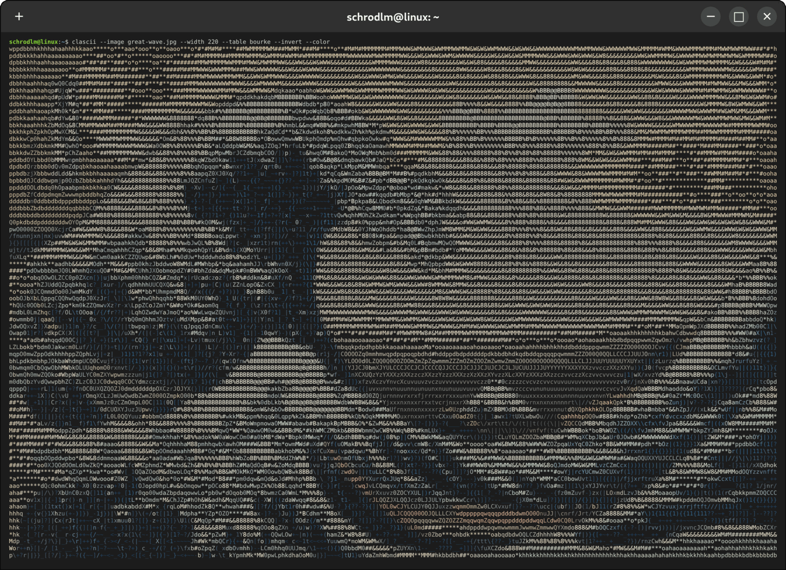
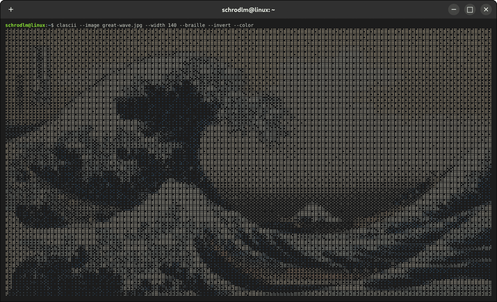
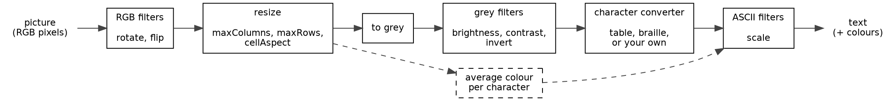

# Clascii

[](https://www.npmjs.com/package/clascii)
[](https://central.sonatype.com/artifact/io.github.schrodlm/clascii_2.13)
[](https://github.com/schrodlm/clascii/releases)
[](https://github.com/schrodlm/clascii/actions/workflows/ci.yml)
[](https://github.com/schrodlm/clascii/actions/workflows/demo.yml)
[](LICENSE)

Clascii turns images, videos, really anything you can turn into pixel, into ASCII art.

- **Characters**: predefined tables, tables of your own, or braille with three ways of dithering.
- **Colours**: optionally, each character carries the colour of the part of the picture it stands for.
- **Filters**: rotate or flip the picture, change its brightness or contrast or invert it, and scale
  the finished art.

**Live demo: https://schrodlm.github.io/clascii/** (even with live camera, hell yeah)

It comes three ways:

- a package for JavaScript and TypeScript
- a Scala library for the JVM and Scala.js
- a command-line tool that reads PNG, JPEG, GIF, BMP and TIFF files and prints the art to your
  terminal, or to a file, in 24-bit colour



## JavaScript and TypeScript

```bash
npm install clascii
```

The package is the same Scala code as the library below, compiled to a JavaScript module with
Scala.js. It has no dependencies and runs in browsers and in Node. Because JavaScript can pass
anything, it checks every value and throws an `Error` that says what is wrong, and its TypeScript
types describe every setting, so your editor lists them as you type.

A picture from a canvas:

```js
import { render } from "clascii";

const canvas = document.querySelector("canvas");
const pixels = canvas.getContext("2d").getImageData(0, 0, canvas.width, canvas.height);

document.querySelector("pre").textContent = render(pixels, { maxColumns: 100 }).text;
```

A live camera, in braille. Drawing each frame at about 4 pixels per column first lets the browser
do the shrinking, which keeps every frame quick:

```js
const video = document.querySelector("video");
video.srcObject = await navigator.mediaDevices.getUserMedia({ video: true });
await video.play();

const frame = document.createElement("canvas").getContext("2d", { willReadFrequently: true });
const columns = 120;

function draw() {
  frame.canvas.width = columns * 4;
  frame.canvas.height = Math.round(frame.canvas.width * video.videoHeight / video.videoWidth);
  frame.drawImage(video, 0, 0, frame.canvas.width, frame.canvas.height);
  const pixels = frame.getImageData(0, 0, frame.canvas.width, frame.canvas.height);
  const art = render(pixels, { maxColumns: columns, characters: { braille: "ordered" }, greyFilters: [{ type: "invert" }] });
  document.querySelector("pre").textContent = art.text;
  requestAnimationFrame(draw);
}
requestAnimationFrame(draw);
```

Your own characters, in colour:

```ts
import { render, type ColoredArt } from "clascii";

const art: ColoredArt = render(pixels, { characters: { chars: " .:-=+*#%@" }, colors: true });
// Red, green, blue and alpha for every character: paint each one in its colour.
const colours = new ImageData(art.colors, art.columns, art.rows);
```

## Scala

```scala
libraryDependencies += "io.github.schrodlm" %%% "clascii" % "0.1.0"
```

The library is plain Scala with no dependencies, for the JVM and for Scala.js. You hand it an image
and settings, and it hands back the art:

```scala
import clascii.core.characters.Dither
import clascii.core.conversion.BrailleConverter
import clascii.core.image.RGBImage
import clascii.core.pipeline.{AsciiArtPipeline, RenderSettings}

// One Int per pixel, 0xAARRGGBB, row by row.
val image = new RGBImage(width, height, pixels)
val settings = RenderSettings(maxColumns = 100, characterConverter = new BrailleConverter(Dither.Diffusion))

println(AsciiArtPipeline.render(image, settings).toText)
```

Filters and character converters are open traits, so filters and ways of drawing of your own fit in
beside the built-in ones.

## Command line

The tool runs from a clone of this repository, with a JDK and [sbt](https://www.scala-sbt.org/):

```bash
sbt "cli/run --image photo.jpg --braille --invert --color --output-console"
sbt "cli/run --help"
```

The screenshots write `clascii` for `sbt "cli/run …"`.



## Demo page

**[Try it in your browser](https://schrodlm.github.io/clascii/)**: every setting, on a
generated picture, an image or a video of your own, or your camera. Nothing leaves your browser. A
stats panel shows the frame rate, how long each part of a frame takes, and how the picture is shrunk
into characters.


To run it locally, build it next to the page and serve the folder:

```bash
sbt js/demo
python3 -m http.server 8137 --directory js/demo
# then open http://localhost:8137
```

## How it works



Every picture goes through the same steps, left to right:

1. **RGB filters** change the picture: rotate, flip.
2. **Resize** shrinks it to the size of the art.
3. It is turned **grey**.
4. **Grey filters** change the greys: brightness, contrast, invert.
5. The **character converter** turns the greys into characters.
6. **ASCII filters** change the finished characters: scale.

The converter decides how many pixels one character stands for, and the resize delivers exactly
that many: one pixel for a table, a block of 2 by 4 for braille. That is where braille's extra
detail comes from.

With colours on, each character also keeps the average colour of the pixels it covers. Grey
filters change the characters not the colours.

## Architecture


The project has three sbt modules:

- **core** is the converter, plain Scala without any input or output, compiled both for the JVM and
  for JavaScript. It is published to Maven Central as `clascii`.
- **cli** reads image files, parses the options and prints the art. It runs on the JVM.
- **js** turns core into a JavaScript library with Scala.js. It checks every value JavaScript
  passes in, since JavaScript can pass anything, and hands back plain objects. Its types are
  written by hand in `js/package/index.d.ts`. It is published to npm as `clascii`.

## Development

You need a JDK and sbt, and Node (tested with 20) for the JavaScript side. Once, install the
package's build tools:

```bash
cd js/package && npm ci
```

Then:

```bash
sbt test                       # every test: core on the JVM and on JS, the CLI, the JS library
                               # against the development and the minified build, and the types
sbt js/npmPackage              # builds the npm package in js/package
node js/bench/render.bench.mjs # times render on webcam, HD and full HD frames (after sbt js/fullLinkJS)
```

The diagrams are drawn with Graphviz: `dot -Tpng -Gdpi=150 docs/pipeline.dot -o docs/pipeline.png`,
and the same for `architecture.dot`.

## Licence

[MIT](LICENSE). The picture in the screenshots is *The Great Wave off Kanagawa* by Katsushika
Hokusai (about 1831), which is in the public domain.
